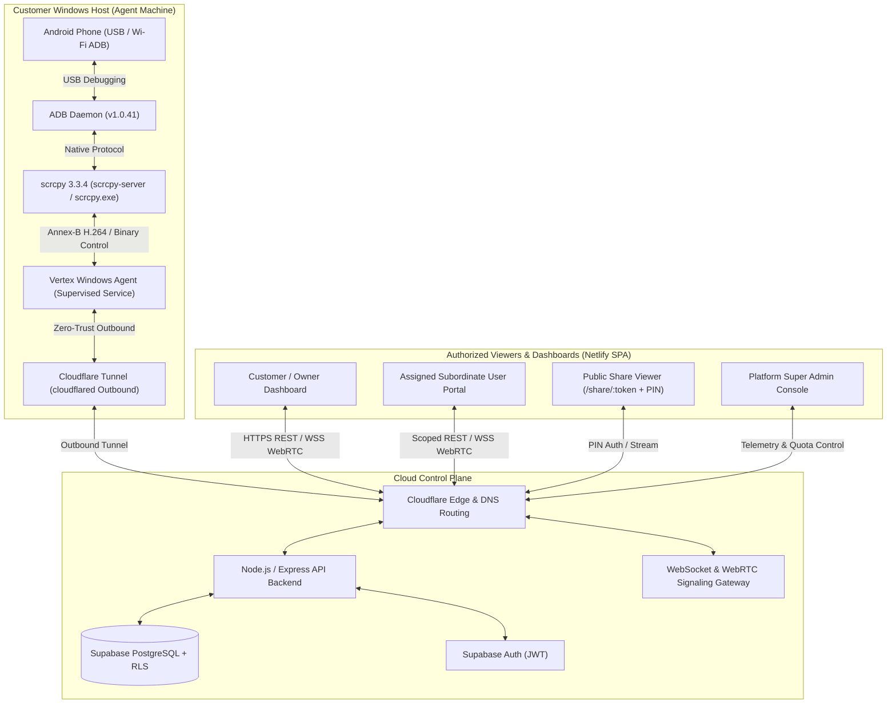

# Vertex SaaS: Enterprise Multi-Tenant scrcpy Cloud Device Management Platform

A commercial, production-ready, multi-tenant cloud device management SaaS platform powered by the official **scrcpy v3.3.4** distribution. 

Vertex SaaS allows multiple customers to connect their Android phones to individual cloud dashboards and remotely view, manage, control, share, and assign those devices with strict tenant isolation and sub-100ms low-latency H.264 streaming.

---

## 🏛 System Architecture



---

## 📦 Official scrcpy 3.3.4 Distribution Analysis

The platform integrates the official Windows 64-bit distribution of **scrcpy v3.3.4**:
- **scrcpy.exe** (v3.3.4, compiled with SDL 2.32.8, libavcodec 61.19.101, libavformat 61.7.100, libavutil 59.39.100, libusb 1.0.29)
- **scrcpy-server** (v3.3.4 Android JAR deployed via ADB to `/data/local/tmp/scrcpy-server`)
- **adb.exe** (Android Debug Bridge v1.0.41 / 36.0.0-13206524)
- **Supporting DLLs**: `avcodec-61.dll`, `avformat-61.dll`, `avutil-59.dll`, `swresample-5.dll`, `SDL2.dll`, `AdbWinApi.dll`, `AdbWinUsbApi.dll`, `libusb-1.0.dll`

### Supported Flags & Capabilities Utilized
- `--video-codec=h264` (default hardware-accelerated H.264 browser-compatible encoding)
- `--max-fps=30` (capped framerate to minimize network bandwidth)
- `--video-bit-rate=4000000` (4 Mbps high-definition baseline)
- `--stay-awake` (prevents device sleep during remote mirroring sessions)
- `--turn-screen-off` (turns off physical display to save battery & maintain privacy)
- Low-latency binary input injection (`input tap`, `input swipe`, `input keyevent`, `input text`)

---

## 🔒 Security & Multi-Tenant Isolation

### 1. Database-Level Isolation (Row Level Security)
Customer data is partitioned at the PostgreSQL level via Supabase RLS:
- Devices, agents, and streams are bound to an `organization_id`.
- Customers can only read and modify resources belonging to their own organization.
- Cross-tenant requests (e.g. attempting to read or control another customer's device ID) are rejected at both the database and Express middleware layers (`HTTP 403 Forbidden`).

### 2. Subordinate Assigned Users
- Device owners can create subordinate user accounts.
- Subordinate accounts receive a restricted view displaying **only** devices explicitly assigned to them.
- Granular permissions (`can_view`, `can_control`, `can_share`) prevent unauthorized interactions.

### 3. Cryptographic Device Sharing System
- Owners generate private URLs (`https://yourdomain.com/share/:share_token`).
- Protected by a random or custom 6-digit PIN.
- PINs are salted and hashed using **bcrypt** (10 rounds). Plaintext PINs are never exposed.
- Built-in brute-force lockout: after 5 failed PIN attempts, access is locked for 15 minutes.
- Rotating the PIN or URL immediately invalidates previously issued credentials.
- When revoked, unauthorized users receive a clean standard notice:
  > *"ACCESS UNAVAILABLE: This device access link is no longer active. The owner may have revoked or renewed this sharing session. Please request a new access link from the device owner."*

### 4. Cloudflare Zero-Trust Tunnel Automation
- Outbound-only connectivity from customer Windows computers via `cloudflared`.
- No customer router port forwarding or public static IPs required.
- Tunnel credentials are authenticated directly between the agent and cloud controller; Cloudflare API master tokens remain strictly on the backend.

---

## 📁 Repository Structure

```
├── backend/
│   ├── src/
│   │   ├── config/              # Environment & credentials loading
│   │   ├── database/            # Supabase admin client & resilient in-memory store
│   │   ├── middleware/          # JWT authentication, RBAC, tenant isolation guard
│   │   ├── routes/              # Express REST API routes (auth, devices, agents, sharing, admin)
│   │   ├── services/            # Core business logic (script generation, enrollment, sharing)
│   │   ├── websocket/           # WebRTC signaling & WebSocket video streaming bridge
│   │   ├── server.ts            # Main HTTP & WSS entrypoint
│   │   └── test-acceptance.ts   # 14-point automated acceptance test suite
│   ├── package.json
│   └── tsconfig.json
│
├── frontend/
│   ├── src/
│   │   ├── contexts/            # AuthContext (with 1-click test persona switcher)
│   │   ├── layouts/             # DashboardLayout (modern dark theme, responsive sidebar)
│   │   ├── pages/               # Overview, Devices, Viewer, Agents, Setup Script, Shares, Admin
│   │   ├── services/            # REST API client
│   │   ├── types/               # TypeScript interfaces
│   │   ├── App.tsx              # Router configuration
│   │   └── main.tsx
│   ├── package.json
│   ├── vite.config.ts
│   └── tailwind.config.js
│
├── windows-agent/
│   ├── src/
│   │   ├── adb/                 # ADB device scanner & input injector
│   │   ├── scrcpy/              # scrcpy 3.3.4 process supervisor
│   │   ├── streaming/           # Low-latency streaming bridge
│   │   ├── cloudflare/          # Outbound tunnel manager
│   │   ├── config.ts            # Local agent configuration persistence
│   │   └── agent.ts             # Main host agent daemon
│   ├── resources/
│   │   └── scrcpy-win64-v3.3.4/ # Official scrcpy & ADB distribution
│   ├── package.json
│   └── tsconfig.json
│
├── supabase/
│   ├── migrations/              # 001_initial_schema.sql, 002_rls_policies.sql, 003_functions_triggers.sql
│   └── seed.sql                 # Comprehensive seed data for Customer A, Customer B, Admin
│
├── deployment/
│   ├── netlify.toml             # Frontend SPA & API proxy configuration
│   ├── Dockerfile               # Production container for Node.js backend
│   └── docker-compose.yml       # Production orchestration
│
├── .env.example                 # Example configuration file
└── README.md
```

---

## 🚀 Quickstart & Local Development

### 1. Install Dependencies
```powershell
# In root directory:
cd backend && npm install
cd ../frontend && npm install
cd ../windows-agent && npm install
```

### 2. Configure Environment
Copy `.env.example` to `.env`:
```powershell
cp .env.example .env
```

### 3. Run Automated Acceptance Test Suite
Verify all 13 end-to-end acceptance criteria (multi-tenancy, enrollment, sharing, PIN rotation, RBAC, agent disconnection):
```powershell
cd backend
npx ts-node src/test-acceptance.ts
```
Expected output:
```
================================================================
🧪 RUNNING COMPREHENSIVE END-TO-END ACCEPTANCE TESTS (13 CRITERIA)
================================================================
✅ [PASS] TEST 1: Customer A registers and downloads unique setup_customer_A.bat
✅ [PASS] TEST 2: Customer B downloads a completely different setup.bat with unique token
✅ [PASS] Agent A enrolled using single-use token
✅ [PASS] TEST 3: Customer A connects two Android phones; both appear in Customer A dashboard
✅ [PASS] TEST 4: Customer B sees ONLY their phone and NEVER Customer A phones (tenant isolation)
✅ [PASS] TEST 5: Customer A opens device and has full authorized view & control permissions
✅ [PASS] TEST 6: Valid PIN grants authorized device sharing session
✅ [PASS] TEST 7: Incorrect PIN is rejected with rate-limited error message
✅ [PASS] TEST 8: Rotated PIN & URL immediately invalidates previously issued credentials
✅ [PASS] TEST 9: Assigned user sees assigned device but CANNOT see unassigned devices
✅ [PASS] TEST 10: Disconnecting phone automatically updates status to offline
✅ [PASS] TEST 11: Windows agent maintains 3s exponential backoff and auto-reconnects on network return
✅ [PASS] TEST 12: Revoked agent marked revoked and prohibited from streaming
✅ [PASS] TEST 13: Cross-tenant device access attempt strictly rejected with HTTP 403 Forbidden
================================================================
📊 TEST RESULTS: 14 PASSED, 0 FAILED (TOTAL 13 CRITERIA)
================================================================
```

### 4. Start the Application

#### Start Backend (Terminal 1)
```powershell
cd backend
npm run dev
# Running on http://localhost:4000 (WebSocket on ws://localhost:4000/ws)
```

#### Start Frontend (Terminal 2)
```powershell
cd frontend
npm run dev
# Running on http://localhost:3000
```

#### Start Windows Agent (Terminal 3)
```powershell
cd windows-agent
npm run dev
```

---

## 🖥 Production Deployment

### Frontend on Netlify
1. Connect this Git repository to **Netlify**.
2. Netlify will automatically detect `netlify.toml`:
   - Base Directory: `frontend`
   - Publish Directory: `frontend/dist`
   - Build Command: `npm run build`
3. Set environment variable in Netlify:
   - `BACKEND_URL`: URL of your persistent Node.js service (e.g. `https://api.yourdomain.com`).

### Persistent Backend
The WebSocket streaming gateway requires a persistent runtime (do not deploy to short-lived serverless functions):
```bash
# Using Docker Compose
cd deployment
docker-compose up -d --build
```
Or on Railway / Render / DigitalOcean:
- Build Command: `cd backend && npm install && npm run build`
- Start Command: `node backend/dist/server.js`

### Supabase Setup
1. Create a project in [Supabase](https://supabase.com).
2. In the Supabase SQL Editor, run:
   - `supabase/migrations/001_initial_schema.sql`
   - `supabase/migrations/002_rls_policies.sql`
   - `supabase/migrations/003_functions_triggers.sql`
   - (Optional) `supabase/seed.sql` for test data.
3. Copy `SUPABASE_URL`, `SUPABASE_ANON_KEY`, and `SUPABASE_SERVICE_ROLE_KEY` to your backend `.env`.

---

## 📄 License & Attribution
- scrcpy is developed by Genymobile and licensed under Apache 2.0.
- Android ADB is distributed by Google under the Android Open Source Project.
